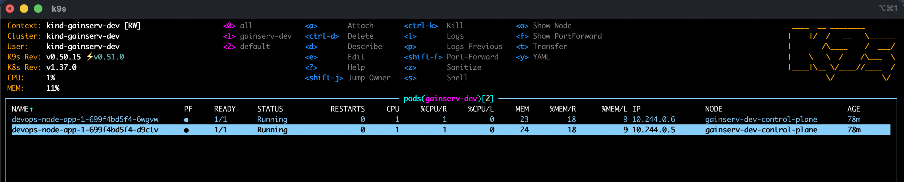
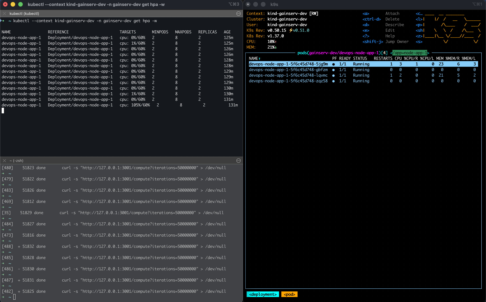

# Gainserv Practical

This project turns the sample Node.js app into an EKS-ready deployment that is secure, autoscaling, and cost-conscious.

## Repo layout

- `app/` - the sample application
- `Dockerfile` - container build for the app
- `compose.yaml` - local Docker Compose run
- `eks/base/` - Kubernetes deployment, service, HPA, network policy, and service account
- `eks/overlays/dev/` - local dev overlay
- `terraform/project-eks/` - Terraform for the AWS-side supporting infrastructure
- `terraform/modules/networking/` - reusable networking module using `for_each`
- `screenshots/` - verification screenshots

## What this app does

The service exposes:
- `/` - basic service metadata
- `/healthz` - readiness/liveness probe endpoint
- `/compute` - CPU-heavy endpoint used to generate load and verify HPA behavior

## Local validation

Build and run locally with Docker Compose:

```bash
docker compose up --build -d
curl http://127.0.0.1:3000/healthz
curl http://127.0.0.1:3000/
```

Render the Kubernetes manifests:

```bash
kubectl kustomize eks/overlays/dev
```

## EKS security design

The pod is hardened to avoid common production issues:

- runs as a non-root user
- `allowPrivilegeEscalation: false`
- `readOnlyRootFilesystem: true`
- drops all Linux capabilities
- `RuntimeDefault` seccomp profile
- dedicated ServiceAccount for AWS pod access
- network policy restricts inbound and outbound access to only required paths

No secrets are stored in Git, image layers, or manifests. AWS access is handled through EKS Pod Identity and short-lived credentials, so the app gets only the permissions it needs and never uses static keys.

## Scalability and HPA

The app is designed to handle load bursts using the `/compute` endpoint. The HPA is configured to scale based on CPU utilization and keeps a minimum of 2 replicas.

This is important because the CPU-heavy route is the right trigger for scaling tests. A single `/healthz` or `/` request does not generate meaningful CPU load, so `/compute` is used for realistic autoscaling proof.

When traffic spikes, the app should scale out automatically. When the load drops, the HPA should scale back down toward its minimum.

### Local load testing with Kind

A quick way to validate the HPA against the CPU-heavy `/compute` route is to port-forward the service and generate a sustained burst of requests from a local shell:

```bash
kubectl --context kind-gainserv-dev -n gainserv-dev port-forward svc/node-app-1 3000:3000

for i in $(seq 1 500); do
  curl -s "http://127.0.0.1:3000/compute?iterations=50000000" >/dev/null &
done
wait

kubectl --context kind-gainserv-dev -n gainserv-dev get hpa -w
```

This is a practical autoscaling smoke test for a Kind cluster. The service name may vary by deployment, but the important part is to hit `/compute` rather than `/healthz` or `/`, because `/compute` produces the CPU load that triggers the HPA.

## Cost considerations

This app is stateless and CPU-bound, so the design favors small, efficient pods rather than large overprovisioned workloads.

- Keep resource requests close to real usage
- use On-Demand for the baseline workload
- use Spot where appropriate for bursty or disposable capacity
- avoid idle nodes and costly unnecessary networking paths

A real EKS cost trap is data transfer and NAT egress. If the service generates unnecessary outbound traffic or routes through NAT repeatedly, costs rise quickly even when the app itself is small. We keep the networking design tight and restricted to only required egress paths.

## Terraform

The Terraform in `terraform/project-eks` covers the AWS-side support needed for this workload.

### Reusable module and `for_each`

The networking module uses `for_each` over a map to create multiple VPC/network dictionaries instead of a single hardcoded copy. This is better than `count` because:

- resource addresses stay meaningful (`module.networking["eks"]` instead of index-based names)
- removing or adding one environment does not shift the others
- it is safer for future environments and avoids accidental recreation of resources by position

### Validation and backend

The project includes a real S3 remote state backend and DynamoDB lock table configuration. The lock table protects against concurrent Terraform writes to the same state file. Without it, two applies could read the same state, modify AWS resources, and overwrite each other’s changes.

The repo is intentionally validated with:

```bash
terraform init -backend=false
terraform fmt -check
terraform validate
```

This avoids trying to reach a real AWS backend when no account is configured.

## Screenshots

Pod running:



HPA scaling under load:



## Recording

Google Drive recording: https://drive.google.com/drive/folders/12bFhG_VHdfmWfU0ey5yQiHafQ9rtRWUL?usp=sharing

## Summary

This project takes the sample app from a simple local service to an EKS-ready design with secure runtime settings, CPU-driven autoscaling, least-privilege AWS access, and a Terraform structure that is easier to reason about and extend.
